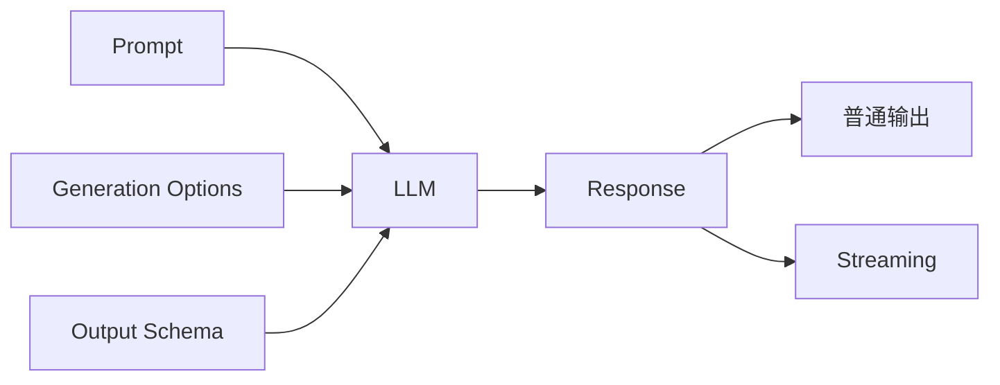

AI工具用了1年多了，一直也没尝试去学习下如何做一个AI工具。能看到最近一段时间每个APP都在为自己的应用增加AI能力。从今天起我打算开启一段AI应用的学习之旅，通过博客记录下每次学习的内容。

软件系统一直以来都是用逻辑来构建一个确定行为的工具。但是从LLM出现之后，似乎出现了一些变化。因为LLM本质上是一个基于概率的语言模型。由于 LLM 采用基于概率的生成机制，相同的输入可能产生不同的输出，而生成内容的正确性也无法得到完全保证。如果把LLM接入到软件系统，在软件的构建过程就需要针对其这种特性进行一些措施。

我们和 AI 进行对话时，最熟悉的就是那个聊天框了。我们输入的内容是 Prompt 的一部分。Prompt 可以包含背景信息、任务指令和输出要求。通过 Prompt，我们可以描述希望 LLM 完成的任务，并引导它生成符合预期的结果。那么基于这些特性，我们就可以通过Prompt来要求LLM的行为和输出的质量尽量一致。但是，我理解Prompt属于软性的要求，也就是提示词直接进入了LLM中，LLM在运行过程中通过概率推测时依然会出现不稳定的情况。

LLM为了满足这些要求，我们在调用LLM的API中除了传Prompt，还可以传递Options和Output Schema。Options里会有一个temperature的参数。在我的实验中，将 Qwen3 8B 模型的 temperature 设置为 0 后，多次调用得到的结果都是一致的。而将 temperature 设置为 1.5 后，生成结果的差异则明显增大。

LLM要和软件集成不能只是纯文本的输出，我们需要对LLM返回的数据进行数据格式的要求。所以在API中还存在有Output Schema。我们通过定义Output Schema可以获得稳定的结构化输出表现。其实我们在Prompt中也可以要求LLM的返回格式，但是与 Prompt 不同，Output Schema 并不只是向模型描述期望的数据结构，而是可以通过约束解码机制，在模型生成内容的过程中限制其输出空间。因此，即使 Prompt 与 Schema 的要求发生冲突，模型也可以按照 Schema 规定的结构进行输出。

我第一次尝试调用 LLM 的接口，给我最大的印象就是慢。可能就一句简单的翻译都需要花费 3～5 秒。为什么使用其他 AI 应用时，没有这么明显的等待感呢？原来它们采用了流式输出的方式。通过 API 接口的 Streaming 参数，使得返回信息像水一样不断流向客户端，而不是等到所有内容生成完毕之后再一次性返回。这种方式虽然不一定能缩短完整响应的时间，却能缩短用户等待首段内容的时间，从而带来更好的用户体验。

看来要将 LLM 接入软件系统，比想象中要复杂。LLM 为软件系统带来了一种新的计算能力，但它的非确定性、输出形式以及生成过程，也打破了我们过去在软件设计中的一些假设。如何将这种基于概率的计算能力集成到一个需要可靠运行的软件系统中，可能正是 AI 应用架构需要解决的核心问题。

