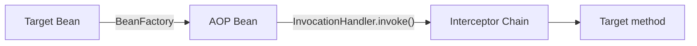
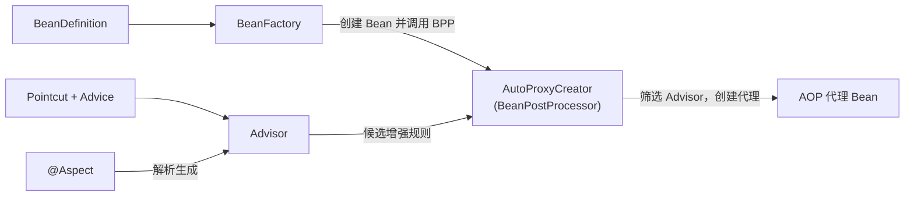
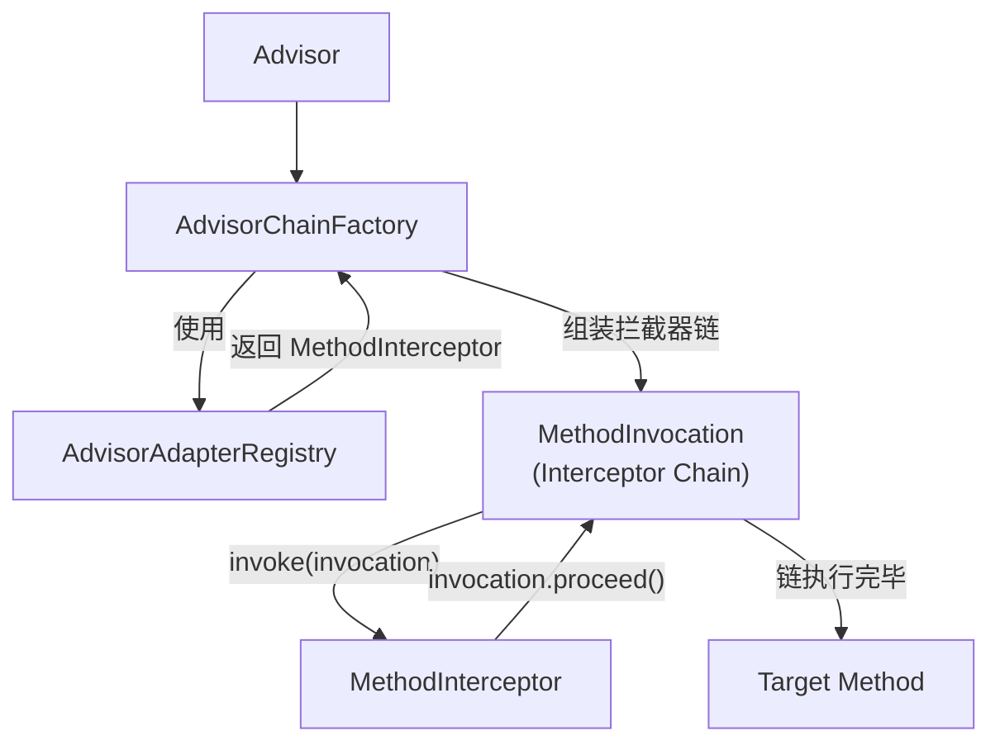

我第一次接触AOP概念就是从Spring开始的。Aspect-oriented Programming 面向切面编程，使用AOP在程序的效果我应该不需要再赘述了。这次我主要是记录下Spring-aop为我们带来了什么，它又是通过怎样的设计来实现的。

Spring-AOP的实现基础就是对象的动态代理机制。JDK 提供了基于接口的动态代理机制，CGLIB 则通过生成目标类的子类实现代理。Spring AOP 同时支持这两种技术，并在它们之上构建了统一的方法增强机制。有了动态代理之后，AOP基于它又给我们做了什么呢？我认为AOP主要做了2件事
- 设计了一套基于interceptor链和声明式切入点的代理执行模型，让我们使用动态代理更方便；
- 与Spring-Beans进行了集成，融入Spring体系；

下面我们使用更细的视角看下AOP在这2方面是如何实现的。
## AOP与Beans的集成
前面我们在“Bean容器的设计”一文中已经提到过，Spring设计了一个`BeanPostProcessor`接口来实现对Bean初始化的扩展。而且`BeanPostProcessor`提供了方法可以实现返回一个代理对象给容器。AOP在这里正是使用`AutoProxyCreator`来实现了将原始Bean包装成代理Bean的。

AutoProxyCreator基于什么信息来创建代理Bean呢？
### Advisor
常见的Advisor是一个包含有“匹配规则”和“增强行为”信息的一个组件，通过一个Advisor我们可以知道我要在哪个方法做什么事。Advisor 将方法匹配规则（Pointcut）与增强行为（Advice）组织在一起。Spring 既支持直接定义 Advisor，也支持解析 @Aspect 声明，生成相应的 Advisor。
AutoProxyCreator生成的代理Bean中包含筛选后适用于该 Bean 的 Advisor。具体哪个方法执行哪些动作是在Bean方法被调用时才进行解析的。下面我们来看AOP的第二段，也是相对复杂的一段。

## AOP的执行

### Interceptor Chain
当代理Bean的方法被执行后，AOP会通过ChainFactory来创建一条interceptor链条，每个interceptor对应advisor里的advice。然后这些interceptor都在一个MethodInvocation的类中被挨个运行。MethodInvocation 负责管理拦截器链的执行。每个 Interceptor 可以通过调用 `invocation.proceed()` 将执行推进到下一个 Interceptor，当拦截器链执行完毕后，最终调用目标方法。
这里的interceptor chain模式和常规的责任链模式有些不一样。常规的责任链会直接调用next来往下推。而Spring AOP 将链的执行状态和推进逻辑封装进独立的 MethodInvocation，而不是让各个 Interceptor 直接管理下一个 Interceptor。
### AdvisorAdapterRegistry
AOP通过AdvisorChainFactory来创建interceptor chain。AdvisorChainFactory 在构建拦截器链时，通过 AdvisorAdapterRegistry 获取统一的 MethodInterceptor。对于已经实现 MethodInterceptor 的 Advice，可以直接使用；其他支持的 Advice 类型，则通过注册的 AdvisorAdapter 进行适配。关于从Advisor到interceptor，在AOP内主要运用了适配器模式和注册表模式。
- 适配器
	Advisor里的Advice有很多种，包括MethodBeforeAdvice、AfterReturningAdvice、ThrowsAdvice等。每一种在执行proceed的时机是不一样的，所以为每种advice都配备了对于的adapter来转interceptor。
- 注册表
    我们需要支持的将adapter注册到Registry中，这样在registry就能识别并转换对应的advice。
将来如果我们需要自定义自己的Advice,就可以通过自定义Adapter再注册的思路来进行扩展。
## 个人体会
Spring AOP 再一次让我看到了 Spring 如何在已有技术之上构建更强大的能力。它并没有重新实现动态代理，而是基于 JDK 和 CGLIB 提供的代理机制，设计了一套由 Advisor 描述增强规则、Interceptor Chain 组织执行的模型。同时通过适配器机制，将不同形式的 Advice 统一到一套执行模型中，进一步提高了扩展能力。再配合 Bean 容器提供的 BeanPostProcessor 扩展点，Spring AOP 实现了代理对象的自动创建，大大降低了使用门槛。在 AOP 中，我还看到了代理模式、适配器模式、责任链模式等设计思想的应用。各组件职责相对独立，把稳定的执行流程与可变化的增强规则分离，使得整个架构更容易扩展。