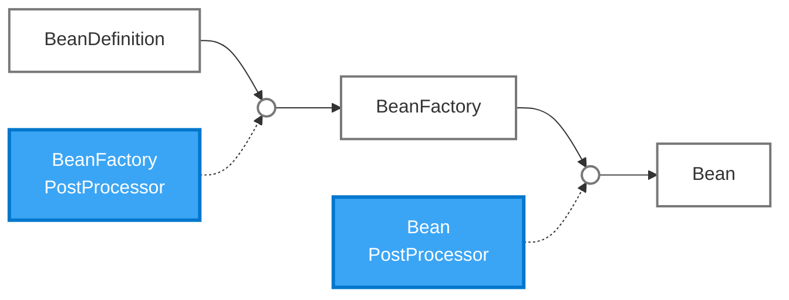
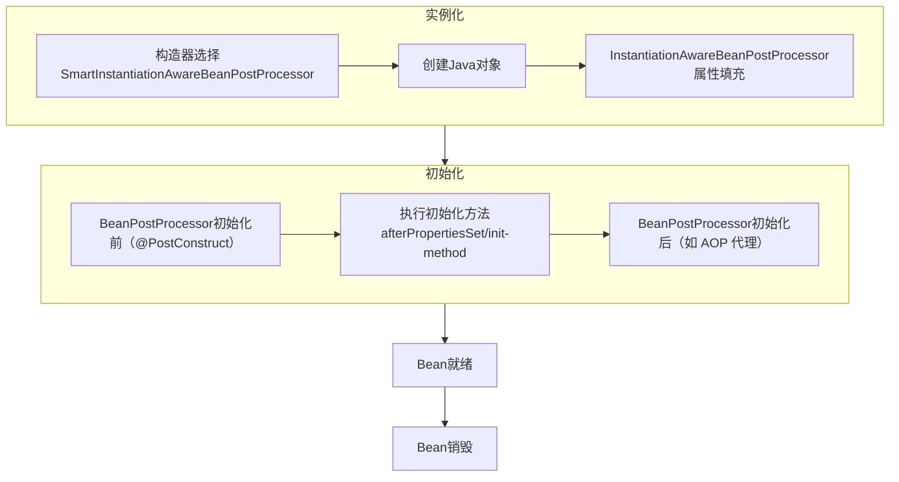
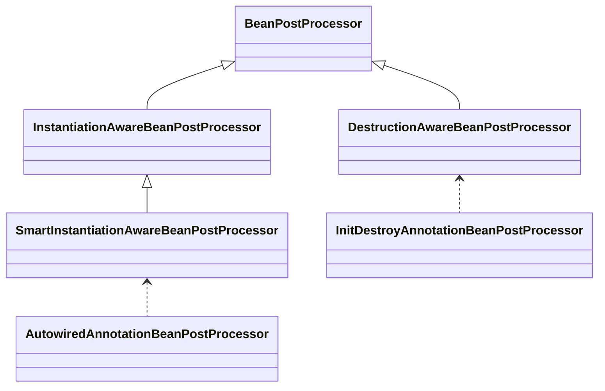

从参加工作开始就使用Spring，Spring从容器到MVC到Cloud，差不多成了Java后端开发的标配。但是，拥有这么多年Spring使用经验的我，至今感觉还只会Spring的一些皮毛，更多在使用Spring提供的能力，而较少思考这些能力时如何设计的，以及如何利用Spring的扩展机制解决更复杂的问题。作为一个发展了这么多年的Spring框架，之所以经久不衰，他的设计理念和架构一定有非常丰富的知识值得我去学习。AI时代的来临，最让我兴奋的一点就是让学习的门槛大大降低，从今天开始我打算写一个关于Spring的学习系列。我将从Spring-beans开始，逐个模块的深入他们的架构思路、组件划分及组件间的协调，内容不会涉及太多的代码实现细节。我的目的就是让我理解Spring的架构设计，学习它组织组件、协调组件及处理变化的思路；了解Spring已经提供了哪些扩展能力，以便未来遇到合适的需求时能够利用它们。

提到Spring应该第一反应就是Bean容器吧。绝大多数人都应该知道Bean容器的好处就是不再需要自己的去new对象，Spring通过Bean容器帮我们托管了对象的实例化。Bean容器作为Spring框架的基础，让Java程序关于对象的创建有了另一种选择。我理解Bean就是Spring世界的对象，所以Bean的创建不仅仅只是new出来就可以了。Spring为Bean设计了一整套逻辑。



## BeanDefinition
一个简单对象只需要new就可以了。如果是复杂对象我们会通过一个工厂模式进行创建，里面会涉及需要给这个复杂对象设置各种依赖属性。而Spring-beans，将new出一个对象的过程抽象成了一个bean构建说明书即BeanDefinition。在BeanDefinition中会包含类的全路径或者工厂方法、依赖、是否单例等等信息。这样就可以用一个工厂来创建所有的bean。
## BeanFactory
BeanFactory作为BeanDefinition到Bean的一个协调者，按照BeanDefinition中定义的说明创建出Bean。看似它就是一个工厂类，但是它除了创建Bean，另外一个职责就是承担了Bean容器的职责。我们`getBean`就是通过它来完成，还有一个最复杂的就是构建了一套Bean创建流程，即Bean的生命周期概念。在生命周期的各个阶段加入了各种BeanPostProcessor的方法调用，为Bean的创建过程提供了灵活性。
## Bean的生命周期



这就是Spring设计的Bean生命周期。从图上就可以看出里面包含大量的PostProcessor。我大致梳理下这个构建过程
- 构造器选择SmartInstantiationAwareBeanPostProcessor：它提供候选构造器选择的扩展能力，具体的注解识别由 `AutowiredAnnotationBeanPostProcessor` 等实现负责；
- 创建Java对象：new出对象；
- InstantiationAwareBeanPostProcessor属性填充：提供属性处理的扩展点，AutowiredAnnotationBeanPostProcessor 通过该扩展点实现 @Autowired 属性注入；
- BeanPostProcessor初始化前（@PostConstruct）：调用写在类上的@PostConstruct的方法；
- 执行初始化方法afterPropertiesSet/init-method：执行afterPropertiesSet/init-method。afterPropertiesSet需要实现InitializingBean，而init-method是在BeanDefinition上定义的；
- BeanPostProcessor初始化后（如 AOP 代理）：给返回代理对象创造了扩展点，后面的AOP基于这里实现的；

## BeanPostProcessor
设想下我们自己构建一个工厂类创建一个对象，如果要提供灵活性应该会在工厂中再集成上策略模式吧。Spring比我们遇到的情况要复杂，为了满足在生命周期中都能提供扩展能力，首先他用BeanPostProcessor来代表这是个用于Bean构建扩展的类。然后在BeanPostProcessor下再扩充了一些包括`InstantiationAwareBeanPostProcessor`、`SmartInstantiationAwareBeanPostProcessor`、`DestructionAwareBeanPostProcessor`等接口，为 Bean 生命周期的不同阶段提供扩展能力。具体的处理逻辑则交给各个实现类完成。
## BeanFactoryPostProcessor
在BeanFactory实例化Bean之前还可以通过BeanFactoryPostProcessor来调整BeanDefinition的属性，为动态修改BeanDefinition提供了可能性。另外，BeanFactoryPostProcessor虽然定义在 spring-beans 模块中，但通常由 ApplicationContext 负责自动发现和调用。他和BeanPostProcessor的处理对象是不同的，一个是BeanDefinition另一个是Bean。这里也体现了我们常用的单一职责原则。

## 生命周期的扩展
我们看看BeanPostProcessor的源码，实际上只有2个方法。他是如何做到能在生命周期中负责这么多个阶段的扩展的呢？
```java
public interface BeanPostProcessor {
	default @Nullable Object postProcessBeforeInitialization(Object bean, String beanName) throws BeansException {  
	    return bean;  
	}
		default @Nullable Object postProcessAfterInitialization(Object bean, String beanName) throws BeansException {  
	    return bean;  
	}
}
```
实际上要做到这些扩展能力2个方法是不行的，最直观的就是方法名称的语义就不满足。所以Spring在BeanPostProcessor扩充了一些接口，接口下面还有实现。


这些就是Spring-beans内的部分BeanPostProcessor。每个接口都在他们的父接口上增加了能力处理特定阶段的能力。BeanPostProcessor 注册到 BeanFactory 后，BeanFactory 会在生命周期的不同阶段识别对应类型的处理器，并调用相应的扩展方法。

## 个人体会
我在设计中经常也会碰到在一个业务流程中需要分段调用接口的场景，但是我多数情况会定义不同的接口。而Spring却没有，Spring让他们都归为一类，都是BeanPostProcessor。这种设计给我造成的最大障碍就是层级关系比较复杂。我在深入Beans模块的架构过程中体会到了Spring为一个本来很简单又很重复的对象构造，设计出了一套Bean体系。在这套体系中构建了Definition、Factory、LifeCycle和Bean。最有特色的一点，是 Spring 通过 PostProcessor 为整个 Bean 体系提供了丰富的扩展能力。它将相对稳定的 Bean 创建流程与容易变化的创建行为分离，使我们能够在不修改核心流程的前提下，扩展 Bean 的创建、依赖注入和初始化等行为。当然，这种设计也增加了接口层级和组件协作的复杂度。