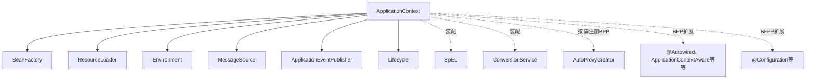

前面六篇分别介绍了 Spring Framework 中的一些基础组件，这次我们来聊聊 spring-context。与其他基础组件不同，ApplicationContext 更像一个集成组件，它将这些基础能力组织起来，形成一个完整的应用上下文。当然Spring给我们设计的应用上下文，应该也是大多数应用所需要的。包括：环境、i18n国际化、资源、AOP和Bean工厂。



ApplicationContext包含了很多内容。由于我把ApplicationContext定义成一个集成组件，所以从集成方式来区分，可以看成3类。
## 1. 对外提供服务类
```java
public interface ConfigurableApplicationContext extends ApplicationContext, Lifecycle, Closeable

interface ApplicationContext extends EnvironmentCapable, ListableBeanFactory, HierarchicalBeanFactory,  
       MessageSource, ApplicationEventPublisher, ResourcePatternResolver
```
我们从上面2个接口的继承关系就可以看出来context直接拥有哪些能力。有些来自另外的包，有些来自context包。Context 通过接口继承统一对外暴露能力，在具体实现中结合继承、组合和委托等方式，复用各个子组件已有的功能。
## 2. 装配类
BeanFactory内部预留了需要表达式和转换器的能力支持，context在集成时将子组件的能力装配到Bean Factory中。SpEL需要配置的是`BeanExpressionResolver`。而context 会检查是否存在名为 `conversionService` 且类型匹配的 Bean，存在时才将它设置到 BeanFactory
## 3.扩展类
BeanFactory 提供了两类重要的扩展机制：BeanFactoryPostProcessor 和 BeanPostProcessor。前者主要负责 BeanDefinition 的处理，后者参与 Bean 的创建过程。Context 借助这两个扩展点，将注解配置解析、依赖注入、Aware 回调和 AOP 自动代理等能力接入容器。例如，`@Configuration` 主要通过 BFPP 体系处理，`@Autowired` 和 AOP 则主要通过 BPP 体系完成。
## 个人体会
我看到很多文章都会仔细分析 ApplicationContext 的核心方法 `refresh()`，但我认为没有必要死记硬背它的执行步骤。当我们分别理解了 BeanFactory、BFPP、BPP、事件机制等组件之后，`refresh()` 的大部分执行顺序其实很容易理解，因为这些组件之间天然存在初始化依赖关系。相比执行步骤本身，我更关注它的设计思想：通过一个统一的启动流程，协调各个独立组件的初始化，并利用模板方法和扩展接口，将稳定流程与可变行为分离。

我在学习context的过程中，更多是关注Spring的设计手法。Spring Framework 将 Bean 容器、资源访问、类型转换、AOP、表达式引擎等基础能力划分到不同模块，再由 spring-context 提供一个更完整的应用容器，将这些能力整合起来。尤其是beans模块提供的2个PostProcessor接口能力，这样的设计让 BeanFactory 可以保持相对独立，不必直接依赖 AOP、SpEL 和完整的应用上下文。Context 则承担集成复杂度，让开发者可以使用一个更完整的容器。代价是集成层需要理解各组件的依赖关系，还需要维护初始化顺序和扩展机制的协调。但相比将所有功能都塞进 BeanFactory，这样的设计显然更有利于模块的独立演进。