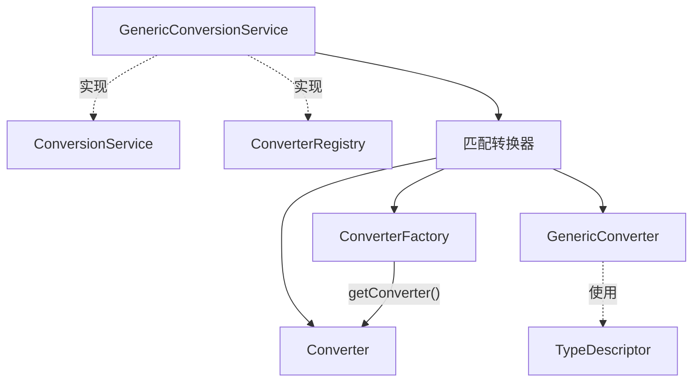

这次来聊聊Converter。写Java到处都是类型转换，我用得最多的是ObjectMapper。Spring内部也为Convert做了支持。一个转换器逻辑很简单提供一种从source到target的转换。

如果我们的目标是设计一个通用的转换器还要考虑它的可扩展性，那么事情就不那么简单了。转换器在设计的时候还要考虑到Java语言的因素，Spring给出的解决方案大致如下：

## Converter
考虑Java语言的设计情况，我们可以定义各种类型Class，可以定义类型的extend继承关系，可以通过泛型定义类似`Rsp<T>`的类型。所以Spring设计了3种类型的Converter。
- Converter：处理一种class到另一种class的转换。
- ConverterFactory: 处理一种源类型到一组具有共同父类型的目标类型的转换，例如 String → Number、String → Enum。
- GenericConverter：支持多组类型之间的转换，并可以借助 `TypeDescriptor` 获取泛型、注解等类型上下文，以处理更复杂的转换场景。
## ConversionService
ConversionService提供统一的类型转换接口，对客户端隐藏具体转换器的查找与调用过程，体现了门面模式（Facade）的设计思想。
## ConverterRegistry
看名称就是知道这就是一个注册表，经过Spring的几个主题学习下来应该很熟悉了。可以addConverter把Convert注册到注册表中。
## GenericConversionService
GenericConversionService实现了ConversionService和ConverterRegistry。它不负责具体的类型转换规则，而是根据客户端指定的源类型和目标类型，查找匹配的转换器，再委托转换器执行。它还通过缓存减少重复查找的开销。 
## 个人体会
针对 Converter 主题，Spring 常用的设计思想再次上演。类型转换的调用流程是相对稳定的，而转换规则、目标类型以及类型信息则存在变化。Spring 将这些变化封装在不同的组件中，通过统一的服务进行协调。识别稳定与变化的部分，仍然是架构设计中最重要也是最困难的事情之一。
