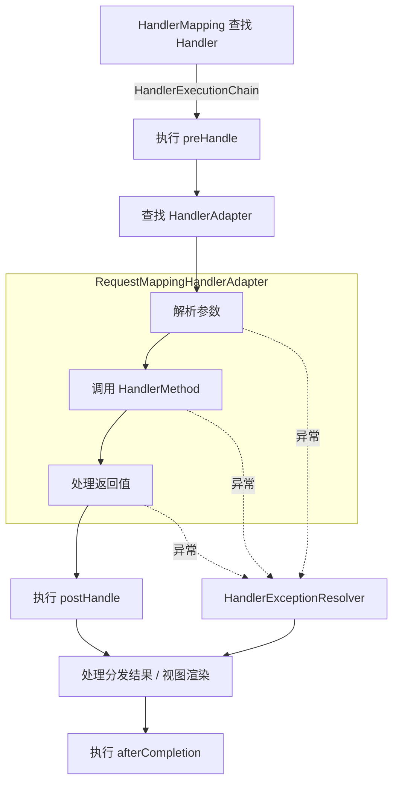

从开始学习Java Web开发时使用的Struts 到后来使用Spring MVC。只知道Spring MVC比Struts方便，不需要定义那些config文件，只需要使用一些注解就可以完成Controller与URI映射配置。一直也没有研究过Spring MVC到底是怎么实现的。直到今天我才认识到Spring MVC其实不是由一堆注解构成的，而它是由DispatcherServlet组织，通过不同扩展点协作构建的一条HTTP请求处理通道。

如果抽象地看，一个 Servlet 的主要工作就是接收 HTTP Request，执行相应的处理逻辑，再通过 HTTP Response 返回处理结果。以前的J2EE可能有很多的Servlet或JSP，而只定义了一个DispatcherServlet来负责所有的请求。这样带来的结果就是在这个Servlet中需要承担更多的职责，包括uri映射、逻辑代码的执行、异常的处理、返回结果的处理。

## DispatcherServlet
DispatcherServlet为这些职责设计了一条固定的处理流程，从第一步做什么直到最后一步。中间几乎每一步都有独自的扩展空间。这种设计方式和context的refresh有一些相似。下面我们来看看可以在DispatcherServlet的流程中做哪些扩展：
- 路由与处理程序Handler的映射：这里有2个概念，分别是怎么样的路由对应怎么样的Handler。我们常用的@RequestMapping就是通过扩展HandlerMapping，定义了`RequestMappingHandlerMapping`来实现的。另外Handler在RequestMappingHandlerMapping里对应的是HandlerMethod。Spring并没有限制HandlerMapping里的Handler只能是HandlerMethod，实际上Handler可以是任何东西。
- 通过Adapter来执行Handler：既然HandlerMapping里的Handler可以是任意东西，那么如果来执行Handler呢。Spring为这种变化增加了一个适配层即HandlerAdapter。这种为同一变化增加适配层的做法之前我们也见过多次了；
- 异常处理：在请求处理过程中发生异常时，DispatcherServlet 可以将异常交给 HandlerExceptionResolver 体系处理。我们常用的 `@ExceptionHandler` 就由 `ExceptionHandlerExceptionResolver` 提供支持。
- 拦截器设计：DispatcherServlet在这条处理链路上还设计了一个拦截器Interceptor链，我们可以在任意的路由中增加想要的拦截器处理；
在这套流程中，我觉得特别值得注意的是 HandlerMapping 与 HandlerAdapter 的分离。Spring 完全可以要求所有 Handler 实现统一接口，这样 DispatcherServlet 找到 Handler 后直接调用即可。但 Spring 并没有选择这种方式，而是引入 HandlerAdapter，让 Handler 不必遵守统一的调用协议。这样无论是传统的 Controller，还是通过注解定义的方法，都可以接入同一套请求处理流程。Spring 付出了额外适配层的复杂度，却换来了 Handler 编程模型的灵活性，以及 DispatcherServlet 调度逻辑的稳定性。
## RequestMappingHandlerAdapter
前面说到Spring并不限制Handler，而使用一个Adapter来统一变化。而RequestMappingHandlerAdapter就是我们用得最多的一个Adapter，因为他和HandlerMethod对应，用于处理类里的方法形式的Handler。 Spring为RequestMappingHandlerAdapter也设计了2个扩展：
- HandlerMethodArgumentResolver 参数解析：我们可以通过扩展HandlerMethodArgumentResolver，来实现一些Handler参数的赋值。
- HandlerMethodReturnValueHandler 返回定制：我们可以通过扩展HandlerMethodReturnValueHandler，来实现一些返回数据的定制。
这2个扩展点都是采用的策略+有序匹配机制的设计模式。
## 个人体会
通过学习DispatcherServlet，更能理解Spring为什么好用。虽然我们更多是使用它的注解来实现功能，但是Spring并没有限制只能用这种方式。同时Spring在为它服务的每个板块定义了一条稳定的结构，在结构中留出了较多的扩展空间。Spring MVC 值得学习的并不只是它提供了多少扩展接口，而是它把请求处理的稳定调度流程与可能变化的 Handler 模型、映射规则、异常处理机制分离开来。Spring 并没有追求最简单的实现，而是通过适度的抽象，为框架的长期演进保留了空间。