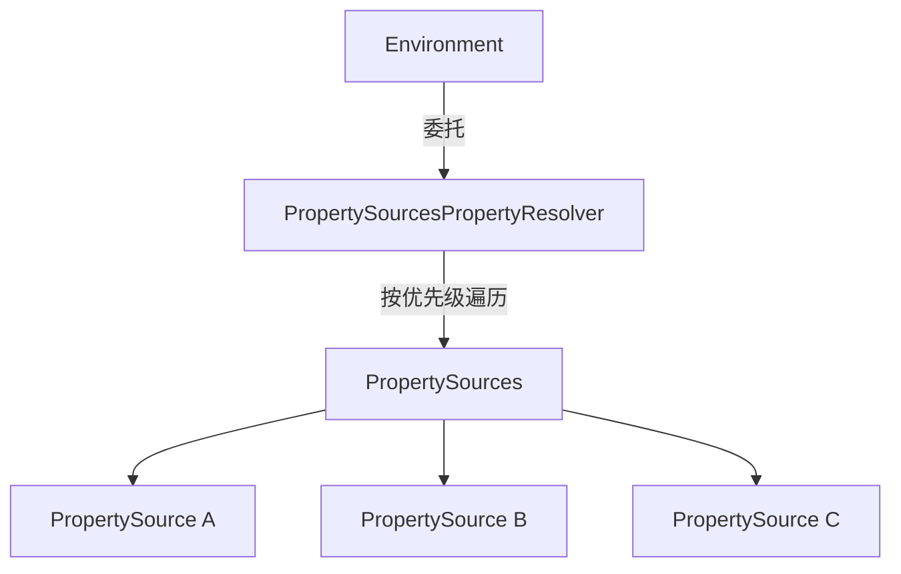

关于系统的配置，在Java里有专门有一个Properties的类来处理这种场景。我们可以通过`getProperty`、`setProperty`来管理配置。而Spring作为系统底座，面对的系统配置场景不止是properties配置文件，还有系统环境变量、jvm变量以及各种外部配置来源。对于这么多种配置需求，Spring为我们抽象了一个PropertySource的概念。

## PropertySource
Spring 将不同的配置来源统一抽象为 PropertySource，通过 `getProperty` 获取属性值。PropertySource 并不限制底层的存储结构，可以是 Map、Properties，也可以是其他数据来源。
## PropertySources
由于会有许多的来源配置为系统贡献配置，所以Spring在PropertySource之上又设计了PropertySources。从字面可以看出它是一个容纳多个PropertySource的容器。我们可以在PropertySources里安排PropertySource的优先级。但是它没有getProperty的能力。
## PropertyResolver
由于最终系统是在PropertySources中获取配置信息，Spring 设计了 PropertyResolver 来统一属性解析能力，其实现类 PropertySourcesPropertyResolver 按照 PropertySources 的优先级查找属性，并提供类型转换、默认值处理、占位符解析等功能。
## Environment
Environment 像是一个门面，客户端通常通过 Environment 获取环境信息。Environment 继承了 PropertyResolver，因此对外提供完整的属性解析能力。但在具体实现中，AbstractEnvironment 并没有亲自实现这些解析逻辑，而是将工作委托给内部的 ConfigurablePropertyResolver，默认使用 PropertySourcesPropertyResolver。

除了属性解析，Environment 还提供了 Profile 的管理与匹配能力。Profile 可以用于控制不同环境下 BeanDefinition 的条件注册。这项能力与属性解析相对独立，但可以通过属性配置激活的 Profile。
## 个人收获
Spring将“系统配置”这个主题拆分成了3个组件，将属性来源、属性来源的组织以及属性解析拆分为三个独立的职责，最后通过 Environment 对外提供统一的访问入口。门面的设计不一定需要重新定义一套 API，它可以通过继承现有接口组合对外能力，再通过委托组织内部实现。