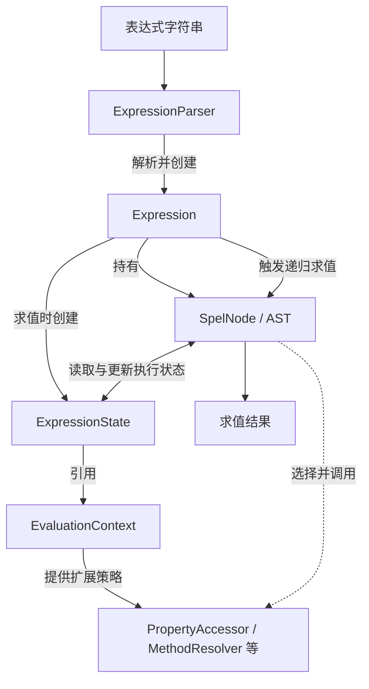

虽然我在实际项目中很少使用 Spring Expression，但作为 Spring 提供的统一表达式引擎，它的架构还是值得研究的。通过学习发现，SpEL 的核心设计与其他表达式引擎有许多相似之处，主要采用 AST 和解释执行模型，并在此基础上提供了运行时环境和执行行为的扩展能力。

动态表达式主要设计2个阶段，分别是parse和eval。通过parse将字符串转换成程序世界的表达式AST，再给AST喂值让其eval出我们需要的结果。

## ExpressionParser、Expression和SpelNode
要开发一个表达式引擎一般都是使用的AST结构，Spring也不例外。`SpelNode` 是 AST 节点的统一接口，具体节点如 `OpAnd`、`OpGE`、`PropertyOrFieldReference` 等通过 `SpelNodeImpl` 实现相关能力。将这些子类进行组合就形成了AST树。ExpressionParser做为从字符串到AST的桥梁，通过解析字符串将其转化成Expression。Expression内部有一颗AST树，这颗树就是由SpelNode构成的。
## EvaluationContext、ExpressionState和PropertyAccessor
求值过程是由Expression的`getValue(EvaluationContext context)`方法来完成。但是Spring和一些简单的表达式引擎不一样的是，他接收的不是一个Map而是EvaluationContext。通过传递一个context上下文，来完成最终的表达式求值过程。与简单表达式引擎直接传入 `Map` 不同，SpEL 通过 `EvaluationContext` 组织变量、属性访问策略、方法解析器、类型转换器等运行时能力。AST 节点因此不必依赖某一种固定的数据访问方式。这样在每个node求值时能共享上下文。另外在具体SpelNode求值是使用的`getValue(ExpressionState expressionState)`这里传递的是ExpressionState，`ExpressionState` 是一次表达式求值的状态载体。它引用 `EvaluationContext`，并维护当前活动对象、嵌套作用域等临时状态，使 AST 节点既能共享执行环境，又能在嵌套求值时保存和恢复状态。
## 个人体会
之前自己也实现过简单的表达式引擎，采用的是 Parser + AST + 递归求值的模型，基本可以满足当时的需求。相比之下，SpEL 更注重通用性和扩展能力。通过 `EvaluationContext` 将表达式的执行逻辑与具体的数据访问方式分离，又通过 `ExpressionState` 将可复用的运行时环境与单次执行状态分离。这让我再次体会到 Spring 对变化点的处理思路：将相对稳定的表达式结构与可能变化的运行时行为分开。不过，这种抽象也增加了组件数量和执行机制的复杂度。对于简单的表达式引擎，并不一定需要这样的设计。
