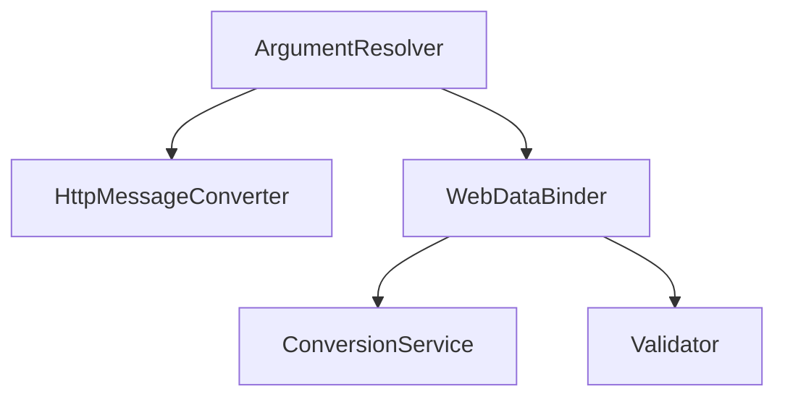
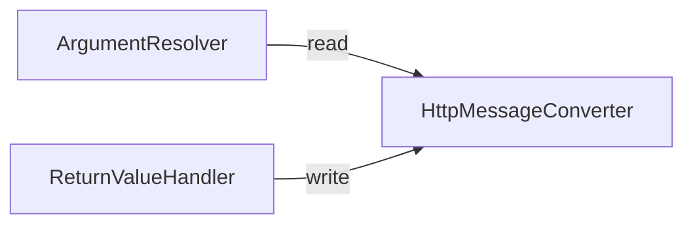
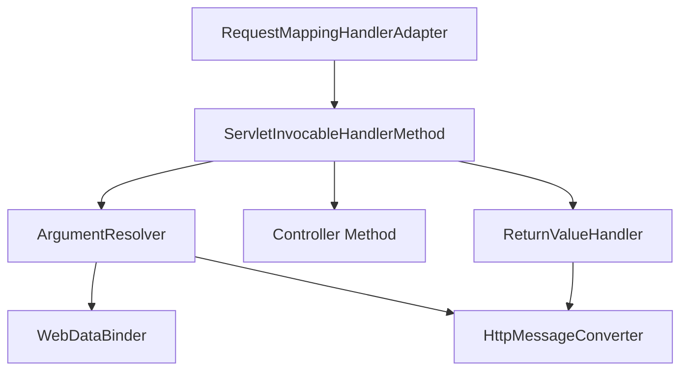

如果说 Spring 通过 DispatcherServlet 组织了一条 HTTP 请求处理流程，那么 RequestMappingHandlerAdapter 则在这条流程中提供了一种以业务方法为中心的编程模型。一次 HTTP 请求的处理，除了核心的业务逻辑，还包含从 HTTP 到 Java，再从 Java 到 HTTP 的转换过程。而我们在使用 Spring MVC 的过程中，很少需要直接操作 HTTP 请求和响应，更多的是在与业务对象打交道。

```java
@PostMapping("/user")
public User create(@RequestBody User user) {
    return userService.create(user);
}
```

当然，这些转换过程并没有消失，只是原本由开发者承担的复杂度被转移到了 Spring 框架内部。相比于 Spring 为我们提供了哪些方便的注解，我更感兴趣的是 Spring 如何组织这些复杂度。从一个 Java 方法调用的角度来看，整个过程其实可以分为三个阶段。


其中方法调用本身并不复杂，真正的复杂度集中在参数准备和返回值处理这两个阶段。
## 参数准备
HTTP 请求中的数据可能存在于 URI、Header、Query 或 Body 中，而 Java 方法的参数又可以是各种不同的类型。为了支持灵活的方法参数声明，Spring 将参数准备的过程抽象成了 HandlerMethodArgumentResolver。不同的 Resolver 根据参数的类型及注解来决定如何生成参数。而在参数生成的过程中，又存在一些可以独立抽象和复用的能力。例如 JSON 消息体的反序列化、请求参数的类型转换、对象的属性绑定以及数据校验。Spring 并没有将这些能力都实现在 Resolver 中，而是将它们进一步分解到 HttpMessageConverter、WebDataBinder、ConversionService 等组件中。



这里的 WebDataBinder 也没有重新实现类型转换的能力，而是利用 Spring 已经提供的 ConversionService，并将属性绑定、数据校验和错误管理组织在一起。

可以看到，Spring 并不是简单地将原本由开发者编写的代码搬到了框架内部，而是对这些复杂度进行了进一步的分解，将其中可以独立变化、可以复用的能力抽象成了不同的组件。
## 返回值处理
相比于参数准备，返回值处理的设计思路与之非常类似。Spring 通过 HandlerMethodReturnValueHandler 来解释方法返回值的语义，再决定如何处理这个返回值。

有意思的是，参数准备和返回值处理虽然是两个独立的过程，却都可能需要 HttpMessageConverter。



在学习这个组件时，我曾经疑惑，为什么 Spring 将读取和写入设计在了同一个接口中，而不是分别定义两种转换器。

后来发现，Spring 的组件划分更多是以消息格式为依据的。同一种消息格式的读取和写入通常具有较强的内聚性，例如 JSON 的读写可以共享同一个 ObjectMapper。而在 MVC 实际执行的过程中，读取和写入又是独立选择 Converter 的，并不要求 HTTP 请求和响应使用相同的消息格式。

这也是一种有意思的组件划分思路。组件并不一定要按照处理流程中的行为来划分，也可以按照需要共同维护的能力来划分。
## 复杂度的转移与组织

回过头来看 RequestMappingHandlerAdapter，它的价值并不在于自身实现了多少功能，而在于组织了一套相对完整的方法调用机制。Spring 为了让开发者能够以普通 Java 方法的形式处理 HTTP 请求，主动承担了原本属于应用开发者的复杂度。同时，又通过对这些复杂度的分解和组织，使框架自身能够应对不同的应用场景。这让我认识到，一个框架的价值不仅在于提供可复用的功能，还在于通过改变开发者的编程模型，让开发者可以专注于真正需要解决的业务问题。框架设计的难点，恰恰在于如何管理这些被转移过来的复杂度。