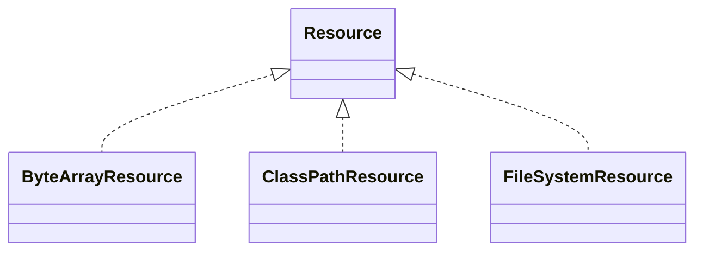
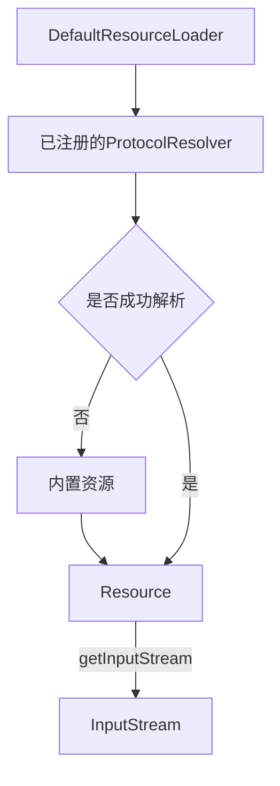
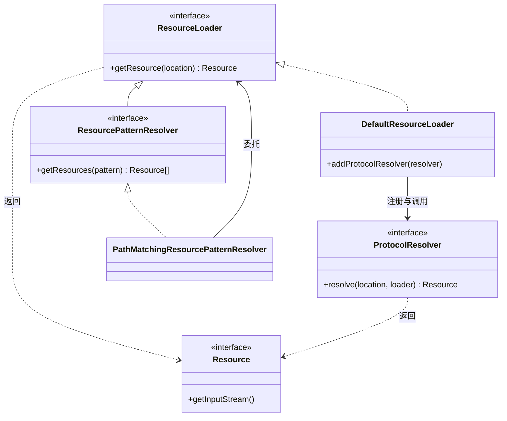

我们在系统开发中应该会碰到读取外部文件的情况，我们可能会直接通过File来读取。Spring 将文件、网络地址、Classpath 中的内容等统一抽象为 `Resource`，为这些不同来源的资源提供统一的访问接口，例如通过 `getInputStream()` 读取内容。

为了配合Resource的使用，Spring设计了一套组件来支撑Resource体系。主要包括`ResourceLoader`、`ProtocolResolver`和`ResourcePatternResolver`。

## DefaultResourceLoader
Spring 默认提供了多种 `Resource` 实现，`DefaultResourceLoader` 会根据资源路径选择合适的实现，例如 `classpath:` 对应 `ClassPathResource`，`file:` 对应 `FileUrlResource`。如果需要支持新的路径协议，例如 `aixming:123`，可以通过 `ProtocolResolver` 扩展资源定位规则，并返回已有或自定义的 `Resource`。`DefaultResourceLoader` 提供了 `addProtocolResolver()` 方法，可以注册自定义解析器。这里 Spring 再一次采用了注册式扩展的设计思路。
## ProtocolResolver
ProtocolResolver中有一个resolve方法。自定义资源解析可以通过他来实现。`DefaultResourceLoader` 会优先调用已注册的 `ProtocolResolver`。如果某个解析器返回了 `Resource`，则直接使用；如果返回 `null`，则尝试下一个解析器，最后回退到 Spring 内置的定位规则。这种设计让外部扩展能够参与甚至覆盖默认行为，而无须修改原有的 `ResourceLoader` 实现。这种类似的扩展设计思路我们在前面的AOP一文中的AdvisorAdapter也看到过。

## ResourcePatternResolver
`ResourcePatternResolver`继承了`ResourceLoader`接口，在原有单资源定位的能力上增加了解析通配符、遍历资源目录、搜索classpath的多个位置来实现一次性取多个Resource。这种类似设计思路我们在前面的Bean容器中的BeanPostProcessor也存在，通过扩展父接口来增加能力，而不是在原有接口中直接增加。
## 个人体会
再一次从 Spring 中看到了如何将一个具体需求抽象为一套可扩展的组件体系。`Resource` 统一资源访问方式，`ResourceLoader` 负责资源定位，`ResourcePatternResolver` 在此基础上扩展了资源搜索能力，而 `ProtocolResolver` 则为资源定位提供了扩展点。

这套设计中既有职责分离，也有接口扩展、对象组合和注册式扩展等常见设计手法。它们并不只适用于资源访问，在其他需要支持多种实现方式、允许外部扩展的场景中，也具有借鉴价值。当然，这种灵活性同样会带来组件数量和协作复杂度的增加，需要根据实际需求取舍。
